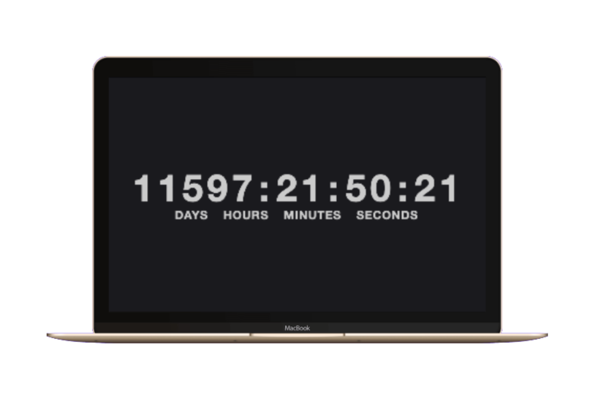
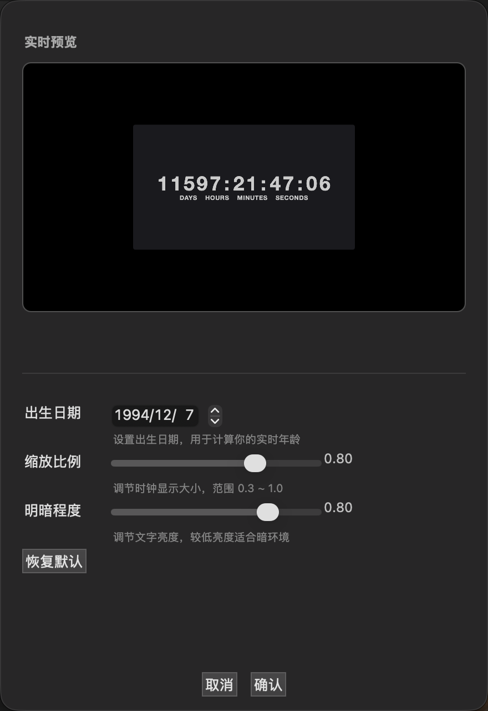
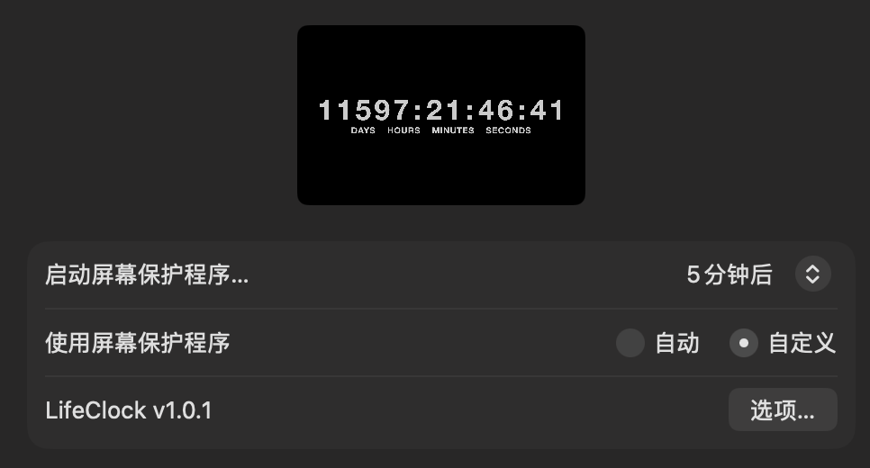

# LifeClock - 人生时钟

创造自己的人生时钟，显示从出生到现在的时间。支持 macOS 屏保。

## 项目概览

本项目 macOS 屏保版位于项目根目录下。

---

## 截图预览

### 屏保预览



在 macOS 系统偏好设置中选择 LifeClock 作为屏保，预览窗口显示自出生日期起已流逝的天:时:分:秒。

### 配置选项



可自定义出生日期、缩放比例、亮度等参数。

### 实时预览配置



配置面板内置实时时钟预览，调整参数时可即时看到效果。

---

## macOS 屏保版

### 功能特点

#### 1. 翻页时钟（Fliqlo 风格）
- 数字采用 Fliqlo 翻页复古效果
- 3D CSS 翻转动画（perspective + rotateX）
- 每张卡牌独立更新，逐位比较触发翻转动画
- 支持天、时、分、秒四位显示

#### 2. 出生日期
- 可自定义出生年月日
- 默认：2000年1月1日
- 从配置的出生日期开始计算已流逝的时间

#### 3. 缩放调节
- 滑块控制显示大小
- 范围：0.3 - 1.0
- 默认值：0.7

#### 4. 亮度调节
- 滑块控制所有文字和符号的颜色亮度
- 范围：0.1 - 1.0
- 默认值：0.3
- 统一应用于所有文字和符号（数字、英文、冒号、单位）

#### 5. 性能优化
- DOM 元素引用缓存，避免每秒重复查询
- ResizeObserver 替代轮询检测尺寸变化
- 动画常量集中管理

### 安装方法

#### 快速安装
1. 双击 `LifeClock.saver`
2. 点击"同意"安装
3. 在系统偏好设置中打开"桌面与屏幕保护程序"
4. 选择 "LifeClock" 并点击"屏幕保护程序选项"进行配置

#### 从源码编译
```bash
cd WebViewScreenSaver
xcodebuild -project WebViewScreenSaver.xcodeproj -target LifeClock -configuration Release build
```

或使用一键编译脚本：
```bash
bash build_saver.sh
```

编译后，屏保文件会生成在项目根目录下。

### 配置说明

1. 打开"系统偏好设置"
2. 进入"桌面与屏幕保护程序"
3. 选择"屏幕保护程序"选项卡
4. 在列表中找到并选择 "LifeClock"
5. 点击右下角"屏幕保护程序选项"按钮
6. 根据需要调整各项设置：
   - 设置出生日期
   - 调整缩放比例
   - 调整亮度

---

## 项目结构

```
LifeClock/
├── index.html                    # 时钟前端页面（基准版本）
├── LifeClock.saver               # 编译好的 macOS 屏保文件
├── WebViewScreenSaver/           # macOS 屏保源码
│   ├── WebViewScreenSaver.xcodeproj
│   ├── Resources/
│   │   └── index.html            # 供屏保使用的 HTML（与根目录同步）
│   ├── WVSSConfig.h/m            # 配置模型
│   ├── WVSSConfigController.h/m  # 配置面板控制器
│   ├── WebViewScreenSaverView.h/m# 屏保主视图
│   └── ...
├── screenshot/                   # 截图
├── build_saver.sh                # 编译脚本
├── install-from-source.sh        # 从源码安装脚本
├── CHANGELOG.md                  # 版本日志
├── README.md                     # 本说明文件
├── LICENSE
└── ...
```

### 共享资源

`index.html` 为时钟前端基准版本，位于项目根目录：
- `WebViewScreenSaver/Resources/index.html` 和 `LifeClock.saver/Contents/Resources/index.html` 由构建脚本自动同步
- 修改只编辑根目录的 `index.html`，运行构建脚本后自动同步到其他位置

---

## 技术说明

### macOS 屏保
- 基于 [WebViewScreenSaver](https://github.com/liquidx/webviewscreensaver) 开发
- 使用 Objective-C 开发 macOS 屏保引擎
- 使用 WebKit 加载和运行 HTML/CSS/JavaScript
- 支持 Apple Silicon 和 Intel 双架构

### 翻页时钟（Fliqlo）
- 纯 CSS 3D 翻转动画实现（perspective + transform-origin + backface-visibility + rotateX）
- 每张卡牌三层架构：flip-digit（底层新数字）+ flip-cover-top（上层旧数字上半翻走）+ flip-cover-bottom（上层新数字下半翻入）
- 逐位比较新旧值，触发有差异的卡牌翻转

---

## 版本日志

### v1.0.3 (2026-10-15)

#### Bug 修复
- **补上 v1.0.2 的盲点**：v1.0.2 只校验 `webView.frame == self.bounds`，一旦 `self.bounds` 本身就是错的，自检判定"正常"、watchdog 静默、注入前端的 `screenWidth` 同样是错的，两道防线全废
- **真正根因（统一日志实测坐实）**：AppKit autoresizing 的加法退化。宿主先把父视图建成 `0×0` 再撑到 `1440×900`，`oldSize = 0×0` 时无法按比例换算，退化为把全部增量加到子视图 → `1440+1440 = 2880`、`900+900 = 1800`。数值恰好像素尺寸只是 scale=2 的巧合，非 Retina 外接屏同样翻倍，故不能依赖倍率判断
- **新增 `syncSelfFrame`**：只认不变量「屏保视图必须与权威参考尺寸（优先 `superview.bounds`）等大」，不等即纠正自身 size 并触发配置重注入

#### 工程改进
- **诊断日志双写到 `os_log`**：容器内的 `diag.log` 读取需要「完全磁盘访问权限」，`log show` 则无需授权，取证通道不再被 TCC 卡死
- **几何快照增加 `superview=` / `ref=`**，并新增 30 秒心跳，可区分"一开始就错"与"中途被改坏"
- **`build_saver.sh` 先在 `/tmp` 暂存目录签名再拷回**：项目位于 iCloud 同步目录下，bundle 带的 `com.apple.fileprovider.fpfs#P` 无法清除，会让 `codesign` 报 detritus 错误

### v1.0.2 (2026-10-15)

#### Bug 修复
- **修复屏保偶发"数字跑到右上角并被裁切一大半"**：`WKWebView` 的 frame 偶发被 AppKit autoresizing 算成屏幕像素尺寸（Retina 下为 points 的 2 倍），非 flipped 坐标系下仅左下象限可见。新增 `syncWebViewFrame` 在 `startAnimation` / `resizeWithOldSuperviewSize:` / `viewDidMoveToWindow` 三处强制纠正 frame
- **修复前端视口无自愈能力**：`ResizeObserver` 改观察 `documentElement`，恢复 `window.resize` / `visualViewport.resize` 监听并合帧节流
- **修复注入的 screenWidth/screenHeight 为死代码**：新增 `resolveViewport()` 交叉校验并钳制像素/点混淆
- **修复 `build_saver.sh` 在签名后覆盖 index.html 导致签名失效**：改为构建前同步，并新增 `codesign --verify`

#### 工程改进
- **frame 自检 watchdog**：每 2 秒校验 WebView frame，异常即纠正
- **离线诊断日志**：几何事件落盘 `~/Library/Logs/LifeClock/diag.log`（1MB 轮转），屏保退出后仍可复盘

### v1.0.1 (2026-09-07)

#### 功能更新
- **亮度控制修复**：亮度设置现在正确控制所有文字和符号（包括翻页数字），不再只控制英文文本
- **DOM 性能优化**：
  - 使用 `Map` 缓存每个 flip-card 的子元素引用，避免每秒多次 `querySelector`
  - 使用 `block.children` 替代 `querySelectorAll('.flip-card')`
  - 使用 `ResizeObserver` 替代 `safetyCheck()` 轮询（每 5 秒强制布局重排 → 仅尺寸变化时响应）
  - 动画时间提取为常量 `FLIP_DURATION_MS` / `FLIP_CYCLE_MS`
  - 缓存数组 `unitsList`、`flipEls` 替代重复 `Object.values()` 和 `querySelectorAll()`
- **代码质量提升**：
  - 全部 `var` 替换为 `const`/`let`，风格统一
  - 删除死代码 `refScreenW`/`refScreenH`
  - 删除冗余的 unit 标签重复赋值
  - 添加强制回流注释说明
  - `flipTo()` 添加新旧字符串长度校验
- **配置注入加强**：新增 `sanitizeConfig()` 函数，对 `screensaverConfig` 和 `reconfigureScreenSaver` 做字段类型和范围校验
- **构建脚本改进**：`build_saver.sh` 支持通用二进制（arm64 + x86_64），自动处理扩展属性清理和签名

#### Bug 修复
- **修复 `decisionHandler` 双重调用崩溃**：`WKNavigationDelegate` 的 `decidePolicyForNavigationAction` 中，`targetFrame == nil` 时调用 `Cancel` 后缺失 `return;`，导致后续又调用 `Allow`，可能引发崩溃
- **修复 `NSSlider.integerValue = NO` 错误用法**：`integerValue` 是 getter 不是 setter，赋值 `NO` 实际将滑块值设为 0；改为 `allowsTickMarkValuesOnly = NO`
- **修复出生日期选择器文字颜色**：`NSDatePickerStyleTextFieldAndStepper` 样式下，白色文字配白色文本框背景不可见，改为黑色文字配白色背景
- **修复 `NSKeyedArchiver`/`NSKeyedUnarchiver` 静默失败**：传入 `nil` error 参数，序列化失败时 `nil` 返回值被直接使用；改为传入 `&error` 并检查返回值
- **修复构建 CodeSign 失败**：`WebViewScreenSaver/Resources/index.html` 被 macOS 自动添加 `com.apple.provenance` 扩展属性，导致 `codesign` 拒绝签名；构建脚本现在自动清理再手动签名

#### Objective-C 代码改进
- **私有 API 防护**：`wvss_setWindowOcclusionDetectionEnabled:` 添加 `respondsToSelector` 防护
- **`defaultBirthDate()` 缓存**：使用 `dispatch_once` 缓存默认日期对象，避免每次调用创建
- **删除已弃用的 `synchronize`**：移除 `[NSUserDefaults synchronize]` 调用（macOS 10.6+ 已无需手动调用）
- **删除未使用的 `bundleHTML` 方法**：清理无引用代码

#### 工程改进
- **`install-from-source.sh` 重写**：修复脚本错误地构建上游 WebViewScreenSaver 而非本地 LifeClock 的问题
- **`build_saver.sh` 增强**：添加 `set -euo pipefail`、`ARCHS="arm64 x86_64"`、源文件扩展属性清理、手动签名逻辑
- **`index.html` 三副本同步**：根目录 `index.html` 为主源文件，构建脚本自动同步到其他位置

### v1.0.0 (2026-07-07)

#### 功能更新
- **翻页时钟效果**：数字改为 Fliqlo 风格翻页复古效果，纯 CSS 3D 翻转动画实现
- **删除时间格式设置**：移除 24小时制/12小时制/中文格式选项，统一为固定格式
- **删除多显示器显示设置**：简化配置面板
- **删除背景显示设置**：移除显示/隐藏黑色背景选项
- **亮度统一控制**：亮度设置现在控制所有文字和符号的颜色，不再区分英文和中文
- **设置页面重新设计**：
  - 深色背景（0.12 灰度）
  - 分区标题（"时间设置"、"显示设置"）
  - 分隔线（NSBoxSeparator）
  - 按钮居中排列
  - 日期选择器深色主题
  - 间距优化（sectionGap 16, itemGap 4）

#### Bug 修复
- **修复时钟不居中问题**：将 CSS 定位从 absolute+translate 改为 flexbox 居中，添加 resize 事件监听和 visibilitychange 处理
- **修复预览框顶部被裁剪问题**：移除动态窗口高度调整逻辑，窗口保持固定 640 高度
- **修复出生日期配置不生效的问题**：配置通过 `didFinishNavigation` 回调注入，确保页面完全加载后再调用 `window.reconfigureScreenSaver()`
- **修复 `stopAnimation` 条件写反**：非预览模式下正确清理 webview 和 timer
- **修复 `WVSSConfig.m` 默认值读取逻辑**：`scale`/`brightness` 使用显式 `objectForKey:` 判断，避免 `floatForKey` 返回 `0.0` 时的误判
- **修复 `_Nonnull` 与 `nil` 矛盾**：移除不安全声明
- **修复 `NSDateFormatter` 格式稳定性**：添加 `en_US_POSIX` locale 和 `localTimeZone`

#### 前端优化
- **差量更新 DOM**：时钟数字块在 HTML 中预创建，`tick()` 只更新 `textContent`
- **翻页动画逐位触发**：通过 `dataset.value` 和逐位比较，仅对有差异的卡牌触发翻转动画
- **移除无意义的三元表达式**：简化代码

#### Objective-C 代码改进
- **替换废弃 API**：`NSKeyedArchiver`/`NSKeyedUnarchiver` 升级为支持 `requiringSecureCoding` 的版本
- **清理未使用代码**：删除已失效的 URL 查询参数拼接逻辑
- **配置面板增强**：日期选择器增加本地时区设置

#### 工程改进
- **新增一键编译脚本**：`test.sh` 支持用 `clang` 直接编译
- **新增双击安装脚本**：`Install.command` 双击即可在 Terminal 中执行编译安装
- **版本号更新**：`CFBundleShortVersionString` / `CFBundleVersion` 更新为 `1.0.0`
- **目录结构优化**：README.md 和 index.html 整理到项目根目录

---

## 经验教训

### 1. 系统屏保部署需管理员权限
macOS 系统屏保安装在 `/Library/Screen Savers/` 目录下，需 root 权限才能写入。使用 `osascript` 弹窗请求管理员授权：
```bash
osascript -e 'do shell script "rm -rf /Library/Screen Savers/LifeClock.saver && cp -R /tmp/LifeClock.saver /Library/Screen Savers/LifeClock.saver" with administrator privileges'
```

### 2. 二进制一致性验证
部署屏保后，必须验证系统版本的 MD5 与构建输出一致，否则说明部署未生效：
```bash
md5 /Library/Screen Savers/LifeClock.saver/Contents/MacOS/LifeClock
md5 build/Release/LifeClock.saver/Contents/MacOS/LifeClock
```
如果 MD5 不一致，需检查 `/tmp/` 中转副本是否是最新构建。

### 3. iCloud Drive 导致代码签名失败
iCloud Drive 的扩展属性（extended attributes）会导致 `codesign` 失败。解决方案：使用 `CODE_SIGN_IDENTITY="" CODE_SIGNING_REQUIRED=NO` 跳过签名编译。

### 4. 动态窗口高度调整需谨慎
在 `createCustomControls` 中从顶部向下布局后，再动态缩小窗口高度（`setContentSize`）会导致顶部控件被裁剪。布局应基于最终窗口尺寸，或避免在控件添加后缩小窗口。

### 5. 系统屏保缓存机制
系统安装的 `.saver` 文件可能被缓存。即使替换了二进制文件，系统设置中的配置面板可能仍显示旧版本。需要完全退出系统设置重新打开，或重启系统才能生效。

### 6. Objective-C 中文字符串在二进制中的存储
Objective-C 的 `NSString` 在编译后以 UTF-16LE 编码存储在二进制中。使用 `strings` 命令无法直接搜索到中文字符串，需通过 `xxd` 查看 UTF-16LE 编码的十六进制模式来验证。

### 7. 记录经验教训要趁早
在开发过程中遇到的问题，如果不当时记录下来，隔一段时间后就会忘记具体细节和解决方案。所有经验教训应在解决后立即记录。

### 8. 构建脚本必须使用 `set -euo pipefail`
不使用 `set -e` 的构建脚本在 `xcodebuild` 失败后会继续执行，拷贝不存在的构建产物，最终返回成功退出码，给用户误导。`-u` 防止未定义变量，`-o pipefail` 防止管道错误被吞没。

### 9. 文件扩展属性导致 CodeSign 失败
macOS 的 `com.apple.provenance` 扩展属性（由下载或保存操作自动添加）会导致 `codesign` 拒绝签名，错误信息为 `resource fork, Finder information, or similar detritus not allowed`。需要在构建前清理源文件扩展属性，并使用 `xattr -cr` 清理构建产物再手动签名。

### 10. 多个 `index.html` 副本需统一管理策略
项目中有三个 `index.html` 副本（根目录、Xcode Resources、屏保包内），修改时必须同步。最佳实践是只保留一个源文件，构建脚本自动拷贝到其他位置，避免手动同步遗漏。

### 11. 构建后需更新屏保包修改时间
`cp -R` 复制 `.saver` 目录包时，目录自身的修改时间可能不会更新为当前时间，导致访达中显示的不是最新修改日期。构建完成后需执行：
```bash
touch /path/to/LifeClock.saver
```
此操作已在 `build_saver.sh` 中集成，若手动拷贝则需自行执行。

---

## 许可证

继承自 WebViewScreenSaver 的 Apache License, Version 2.0

---

**注意**：首次打开 macOS 屏保时可能需要在"系统偏好设置"->"安全性与隐私"中允许打开未签名的应用。